# apaTables

## Context

Reproducible research is research for which the numbers reported in the
paper can be obtained by others using the original data and analysis
scripts. (Note that this differs from replicability - the extent to
which findings are consistent across samples.) Recent research has
revealed a problem with the reproducibility of analyses in many fields.
For example, in psychology Nuijten et al. (2016) found that about half
of the psychology articles reporting null-hypothesis significance tests
contained at least one reported test statistic (e.g., *t*(24)=22.71)
that was inconsistent with the reported *p*-value. One in eight articles
contained an inconsistency large enough to change the statistical
conclusion. This inconsistency rate suggests there is a major problem
with reproducibility in the psychological literature.

My objective in creating the *apaTables* package was to automate the
process through which tables are created from analyses when using R.
Using *apaTables* ensures that the tables in your manuscript are
reproducible.

Although a number of table generation packages exist for R they are
typically not useful for psychology researchers because of the need to
report results in the style required by the [American Psychological
Association](http://www.apa.org); that is, [APA
Style](http://www.apastyle.org/products/asc-landing-page.aspx).
Consequently, *apaTables* creates [Microsoft
Word](https://products.office.com/en-ca/word) documents (.docx files)
that contain tables that conform to APA Style. Tables can also be placed
in [Quarto](https://quarto.org) documents – Quarto is a free system for
writing documents that combine text and R code. With the
[apaquarto](https://wjschne.github.io/apaquarto/) extension, each table
appears fully formatted – number, title, and note included – when the
document is rendered to Word, PDF, or HTML. Installing the apaquarto
extension takes one command; see the [installation section of the
apaquarto
guide](https://dstanley4.github.io/apaTables/articles/apaquarto-usage.html#installing-the-apaquarto-extension)
on this site. Both workflows are shown for every table below.

In many cases it would be necessary to execute additional R commands to
obtain all of the statistics needed for an APA Style table. For example,
if conducting a regression using the **lm** command the unstandardized
regression (i.e., b) weights are reported. Additional commands are
needed to obtain standardized (i.e., beta) weights. *apaTables*
automatically executes these additional commands to create a table with
the required information in Microsoft Word .docx format via
[`apa.save()`](https://dstanley4.github.io/apaTables/reference/apa.save.md)
or in a Quarto document via
[`apa.quarto.pdf()`](https://dstanley4.github.io/apaTables/reference/apa.quarto.pdf.md).

Additionally, the [American Statistical
Association](http://www.amstat.org) recently released a [position
paper](https://www.amstat.org/asa/files/pdfs/p-valuestatement.pdf) on
the use of *p*-values in research. A component of that statement
indicated that “*Scientific conclusions and business or policy decisions
should not be based only on whether a p-value passes a specific
threshold.*” The Executive Director of the [ASA](http://www.amstat.org)
suggested that [confidence intervals should be used to interpret
data](http://retractionwatch.com/2016/03/07/were-using-a-common-statistical-test-all-wrong-statisticians-want-to-fix-that/).
This statement is consistent with the 1999 [position
paper](http://www.apa.org/science/leadership/bsa/statistical/tfsi-followup-report.pdf)
from the APA Task Force on Statistical Inference. Consequently, the
current version of *apaTables* indicates significance using stars but
more importantly reports confidence intervals for the reported effect
sizes.

Bugs and feature requests can be reported at:
<https://github.com/dstanley4/apaTables/issues>

## Correlation table

Correlation tables can be constructed using the **apa.cor.table()**
function. The constructed table includes descriptive statistics (i.e.,
mean and standard deviation) for each variable and a confidence interval
for each correlation.

The **apa.cor.table()** function creates a correlation table with
confidence intervals based on a data frame. The example below creates an
APA Style correlation table, see Table 1, using the *attitude* dataset
built into *R*.

``` r

library(apaTables)
table1 <- apa.cor.table(data = attitude,
                        table.number = 1)

print(table1)
```

``` r

apa.save(filename = "table1.docx",
         table1)
```

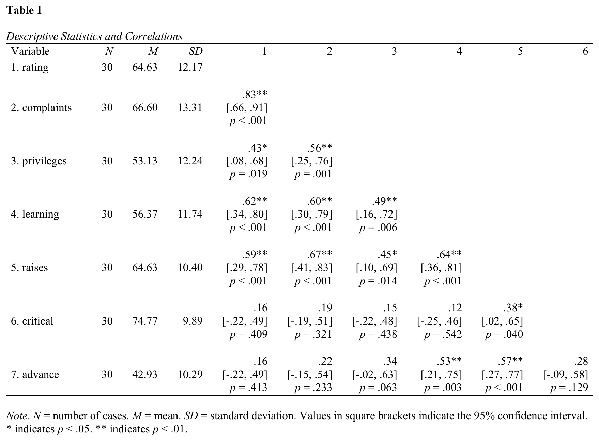

[Quarto](https://quarto.org) is a free system for writing documents that
combine text and R code. The
[apaquarto](https://wjschne.github.io/apaquarto/) extension (one
command; see the [installation
instructions](https://dstanley4.github.io/apaTables/articles/apaquarto-usage.html#installing-the-apaquarto-extension))
makes a Quarto document follow APA style. Place this table in such a
document and it appears as a fully formatted APA table – number, title,
and note included – in Word, PDF, or HTML. Tables go into the document
inside a “code chunk”: a small block of R code with a few settings lines
at the top. “Rendering” the document turns it into the finished Word,
PDF, or HTML file.

Every apaquarto document begins with a YAML header: the settings block
between `---` lines at the very top of the document. apaquarto needs an
author there – with no author, or an empty one, the render stops with a
LaTeX error – and it reports a problem unless that author has an
affiliation and is marked `corresponding: true`. This header is enough
to render:

``` yaml
---
title: "My Paper"
author:
  - name: Jane Doe
    corresponding: true
    affiliations:
      - name: University of Guelph
format: apaquarto-pdf
---
```

There are two ways to produce the chunk that holds the table; most users
only need the first.

**Easy way.** In the R console, create the table and then ask for the
Quarto code:

``` r

library(apaTables)

table1 <- apa.cor.table(data = attitude,
                        table.number = 1)

apa.quarto.template(x = table1)
```

This prints a ready-made Quarto code chunk. It carries no title or note
line and needs none:
[`apa.quarto.pdf()`](https://dstanley4.github.io/apaTables/reference/apa.quarto.pdf.md)
writes both from the table itself, every time you render. Copy the
printed chunk into your Quarto document, add the lines that create
`table1` to the chunk –
[`library(apaTables)`](https://github.com/dstanley4/apaTables) among
them; without it the document cannot find the apaTables commands and the
render stops. Then render the document.

**Advanced way.** Write the code chunk yourself, directly in your Quarto
document.
[`apa.quarto.pdf()`](https://dstanley4.github.io/apaTables/reference/apa.quarto.pdf.md)
displays the table body with the title and note included automatically,
so nothing more than the label is required:

```` markdown
```{r}
#| label: tbl-correlations
#| message: false
#| warning: true
library(apaTables)
table1 <- apa.cor.table(data = attitude)
apa.quarto.pdf(x = table1)
```
````

That `#| label: tbl-correlations` line is not optional: without a label
starting `tbl-`, Quarto builds no float for the chunk, so there is no
number, no title, and no note, however you try to supply them.

One caution for PDF: a correlation table with many variables can be
wider than the upright (portrait) PDF page. This one is not – Table 1
measures about 5.4 inches against the 6.5 inches an upright page gives a
table – but a table with more variables in it would be. APA style places
such a table on a rotated (landscape) page, and apaTables does that for
you: it measures the table, and when it will not fit upright it asks
apaquarto for a rotated page. Nothing has to be added to the chunk and
nothing has to be added to the YAML header – the display line is simply
`apa.quarto.pdf(x = table1)`, and it works whether your tables sit in
the text or are collected at the end of the manuscript. (Documents that
already wrap a chunk in `::: {.landscape}` markers keep rendering
exactly as before; the markers are just no longer something you have to
write.) Word output needs none of this either:
[`apa.save()`](https://dstanley4.github.io/apaTables/reference/apa.save.md)
turns the page to landscape automatically.

**The automatic title and note work identically in PDF, Word, and
HTML.** A chunk rendered to `apaquarto-docx` or `apaquarto-html` shows
the same generated (or your own) title and note a PDF render would – use
[`apa.quarto.docx()`](https://dstanley4.github.io/apaTables/reference/apa.quarto.pdf.md)
or
[`apa.quarto.html()`](https://dstanley4.github.io/apaTables/reference/apa.quarto.pdf.md)
in place of
[`apa.quarto.pdf()`](https://dstanley4.github.io/apaTables/reference/apa.quarto.pdf.md)
to match the YAML `format:` line.
[`apa.save()`](https://dstanley4.github.io/apaTables/reference/apa.save.md),
shown above, remains the way to write a separate Word or HTML file,
outside any Quarto document.

`apa.quarto.template(x = table1)` prints one plain chunk – no title
line, no note line, no wrapper lines, and nothing to add to the YAML
header. It names the chunk after your table object (`tbl-table1`); shown
here with the build lines filled in:

```` markdown
```{r}
#| label: tbl-table1
#| message: false
#| warning: true
library(apaTables)
table1 <- apa.cor.table(data = attitude)
apa.quarto.pdf(x = table1)
```
````

If a table is still too wide for the page – even a rotated one –
apaTables prints it smaller during PDF rendering, as small as it has to
be, so that nothing is cut off. This is automatic; the chunk needs
nothing extra, and there is no setting to change:

``` r

apa.quarto.pdf(x = table1)
```

If fitting the table takes the type below 6 points – where an APA table
stops being comfortable to read – a warning in the rendered draft says
so and points you to
[`apa.save()`](https://dstanley4.github.io/apaTables/reference/apa.save.md)
for a full-size Word version. The table in the PDF is still complete.

## Regression table overview

Regression tables can be constructed using the **apa.reg.table()**
function. The constructed table includes the unstandardized regression
coefficient (*b* with CI), standardized regression coefficient (*beta*
with CI), semi-partial correlation squared (labeled *Unique R*² in the
table, with CI), the correlation ($`r`$), and the overall fit of the
model (indexed by $`R^2`$ with CI). The *album* sales dataset from Field
et al. (2012) is used to illustrate the **apa.reg.table()** function.

## Basic regression table

The **apa.reg.table()** function creates a regression table with
confidence intervals based on **lm()** output; see Table 2.

``` r

library(apaTables)

basic.reg <- lm(sales ~ adverts + airplay,
                data = album)

table2 <- apa.reg.table(basic.reg,
                        table.number = 2)
```

``` r

apa.save(filename = "table2.docx",
         table2)
```

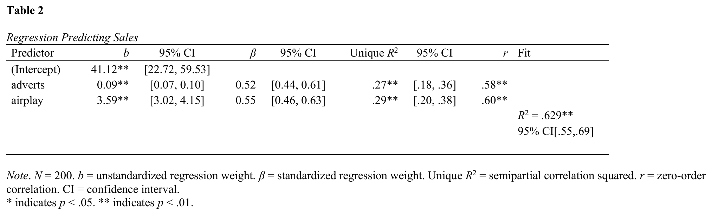

This table can also be placed in a [Quarto](https://quarto.org) document
– Quarto is a free system for writing documents that combine text and R
code. With the [apaquarto](https://wjschne.github.io/apaquarto/)
extension installed (one command; see the [installation
instructions](https://dstanley4.github.io/apaTables/articles/apaquarto-usage.html#installing-the-apaquarto-extension)),
the table appears fully formatted – number, title, and note included –
when the document is rendered to Word, PDF, or HTML. Tables go into the
document inside a “code chunk”: a small block of R code with a few
settings lines at the top. “Rendering” the document turns it into the
finished Word, PDF, or HTML file.

Every apaquarto document begins with a YAML header: the settings block
between `---` lines at the very top of the document. apaquarto needs an
author there – with no author, or an empty one, the render stops with a
LaTeX error – and it reports a problem unless that author has an
affiliation and is marked `corresponding: true`. This header is enough
to render:

``` yaml
---
title: "My Paper"
author:
  - name: Jane Doe
    corresponding: true
    affiliations:
      - name: University of Guelph
format: apaquarto-pdf
---
```

There are two ways to produce the chunk that holds the table; most users
only need the first.

**Easy way.** In the R console, create the table and then ask for the
Quarto code:

``` r

library(apaTables)

basic.reg <- lm(sales ~ adverts + airplay,
                data = album)

table2 <- apa.reg.table(basic.reg,
                        table.number = 2)

apa.quarto.template(x = table2)
```

This prints a ready-made Quarto code chunk. It carries no title or note
line and needs none:
[`apa.quarto.pdf()`](https://dstanley4.github.io/apaTables/reference/apa.quarto.pdf.md)
writes both from the table itself, every time you render. Copy the
printed chunk into your Quarto document, add the lines that create
`table2` to the chunk –
[`library(apaTables)`](https://github.com/dstanley4/apaTables) among
them; without it the document cannot find the apaTables commands and the
render stops. Then render the document.

**Advanced way.** Write the chunk yourself:

```` markdown
```{r}
#| label: tbl-regression2
#| message: false
#| warning: true
library(apaTables)
basic.reg <- lm(sales ~ adverts + airplay, data = album)
table2 <- apa.reg.table(basic.reg)
apa.quarto.pdf(x = table2)
```
````

## Blocks regression table

In many cases, it is more useful for psychology researchers to compare
the results of two regression models with common variables. This
approach is known to many psychology researchers as block-based
regression (likely due to the labeling used in popular software
packages). Using regression to “control” for certain variables (e.g.,
demographic or socio-economic variables) is a common use case. In this
scenario, the researcher conducts a regression with the “control”
variables that is referred to as *block 1*. Following this, the
researcher conducts a second regression with the “control” variables and
the substantive variables that is referred to as *block 2*. If *block 2*
accounts for significant variance in the criterion above and beyond
*block 1* then substantive variables are deemed to be meaningful
predictors.

A second common use of block-based regression in psychology is testing
for continuous-variable interactions. Consider a scenario in which a
researcher is testing for an interaction between two continuous
variables and two regressions are conducted. The first regression
includes the two predictors of interest (*block 1*). The second
regression includes the two predictors of interest as well as the
product term for them (*block 2*). If *block 2* accounts for significant
variance in the criterion above and beyond *block 1* an interaction is
deemed to be present. Admittedly interactions could be tested in a
single regression; however, using a block-based regression for this
analysis is common in psychology. The example below examines whether
advertisements and amount of airplay for a song interact to predict
album sales. The resulting table is presented in Table 3. Although this
example only uses two blocks, note that any number of blocks can be used
with the **apa.reg.table()** function. As well, if the predictors in any
of the blocks are a product-term, the zero-order correlation will be
omitted from the output to prevent interpretation errors common in
psychology.

The **apa.reg.table()** function allows for multiple (i.e., 2 or more)
blocks as per below; see Table 3.

``` r

library(apaTables)

block1 <- lm(sales ~ adverts + airplay, data = album)
block2 <- lm(sales ~ adverts + airplay + I(adverts*airplay), data = album)

table3 <- apa.reg.table(block1, block2,
                        table.number = 3)
```

``` r

apa.save(filename = "table3.docx",
         table3)
```

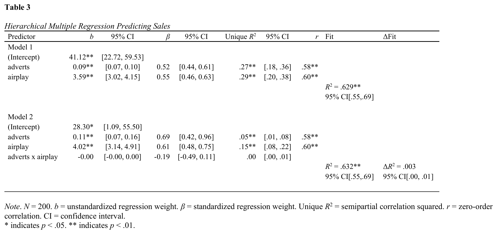

This table can also be placed in a [Quarto](https://quarto.org) document
– Quarto is a free system for writing documents that combine text and R
code. With the [apaquarto](https://wjschne.github.io/apaquarto/)
extension installed (one command; see the [installation
instructions](https://dstanley4.github.io/apaTables/articles/apaquarto-usage.html#installing-the-apaquarto-extension)),
the table appears fully formatted – number, title, and note included –
when the document is rendered to Word, PDF, or HTML. Tables go into the
document inside a “code chunk”: a small block of R code with a few
settings lines at the top. “Rendering” the document turns it into the
finished Word, PDF, or HTML file.

Every apaquarto document begins with a YAML header: the settings block
between `---` lines at the very top of the document. apaquarto needs an
author there – with no author, or an empty one, the render stops with a
LaTeX error – and it reports a problem unless that author has an
affiliation and is marked `corresponding: true`. This header is enough
to render:

``` yaml
---
title: "My Paper"
author:
  - name: Jane Doe
    corresponding: true
    affiliations:
      - name: University of Guelph
format: apaquarto-pdf
---
```

There are two ways to produce the chunk that holds the table; most users
only need the first.

**Easy way.** In the R console, create the table and then ask for the
Quarto code:

``` r

library(apaTables)

block1 <- lm(sales ~ adverts + airplay, data = album)
block2 <- lm(sales ~ adverts + airplay + I(adverts*airplay), data = album)

table3 <- apa.reg.table(block1, block2,
                        table.number = 3)

apa.quarto.template(x = table3)
```

This prints a ready-made Quarto code chunk. It carries no title or note
line and needs none:
[`apa.quarto.pdf()`](https://dstanley4.github.io/apaTables/reference/apa.quarto.pdf.md)
writes both from the table itself, every time you render. Copy the
printed chunk into your Quarto document, add the lines that create
`table3` to the chunk –
[`library(apaTables)`](https://github.com/dstanley4/apaTables) among
them; without it the document cannot find the apaTables commands and the
render stops. Then render the document.

**Advanced way.** Write the chunk yourself:

```` markdown
```{r}
#| label: tbl-regression3
#| message: false
#| warning: true
library(apaTables)
block1 <- lm(sales ~ adverts + airplay, data = album)
block2 <- lm(sales ~ adverts + airplay + I(adverts*airplay), data = album)
table3 <- apa.reg.table(block1, block2)
apa.quarto.pdf(x = table3)
```
````

One caution for PDF: a regression table with several blocks is wider
than the upright (portrait) PDF page. APA style places such a table on a
rotated (landscape) page, and apaTables does that for you: it measures
the table and asks apaquarto for a rotated page when one is needed.
Nothing has to be added to the chunk or to the YAML header – the display
line is simply `apa.quarto.pdf(x = table3)`. This two-block table (Table
3) measures about 7.1 inches: more than the 6.5 inches an upright page
gives a table, but well within the 9 inches of a rotated one. So it
lands on a rotated page at full size with every column present. A table
wider still – wider than even a rotated page – is printed smaller
instead, as small as it has to be so that every column is kept. If that
takes the type below 6 points the rendered draft carries a warning
saying so, and
[`apa.save()`](https://dstanley4.github.io/apaTables/reference/apa.save.md)
Word output turns the page to landscape first, using smaller type only
when even that is too narrow.

This table is wide enough to be rotated, and
`apa.quarto.template(x = table3)` still prints one plain chunk (named
`tbl-table3` after the object) – the rotation is worked out when the
document is rendered, not written into the chunk. Shown with the build
lines filled in:

```` markdown
```{r}
#| label: tbl-table3
#| message: false
#| warning: true
library(apaTables)
block1 <- lm(sales ~ adverts + airplay, data = album)
block2 <- lm(sales ~ adverts + airplay + I(adverts*airplay), data = album)
table3 <- apa.reg.table(block1, block2)
apa.quarto.pdf(x = table3)
```
````

Alongside the chunk it prints the reason, in the words it actually uses:

    This table is about 7.1 inches wide -- too wide for an upright (portrait)
    PDF page. It will be placed on a rotated (landscape) page automatically,
    at full size. There is nothing to add to the chunk or to the YAML header of
    your document.

## 1-way ANOVA and d-value tables

There are three functions in apaTables that are helpful for 1-way ANOVA
analyses within predictor variables that are independent
(**apa.aov.table()**, **apa.1way.table()**, and **apa.d.table()**). All
three are illustrated below. First, however, the ANOVA must be
conducted - we do so using the *viagra* dataset from Field et
al. (2012). When conducting an ANOVA in R using the **lm()** command you
must ensure your independent variables are R factors and that contrasts
are set correctly. Note: repeated measures designs are supported via the
**apa.afex.table()** command.

``` r

options(contrasts = c("contr.sum", "contr.poly"))
lm_output <- lm(libido ~ dose,
                data = viagra)
```

The **apa.aov.table()** function creates a 1-way ANOVA table based on
lm_output; see Table 4.

``` r

library(apaTables)

table4 <- apa.aov.table(lm_output = lm_output,
                        table.number = 4)
```

``` r

apa.save(filename = "table4.docx",
         table4)
```

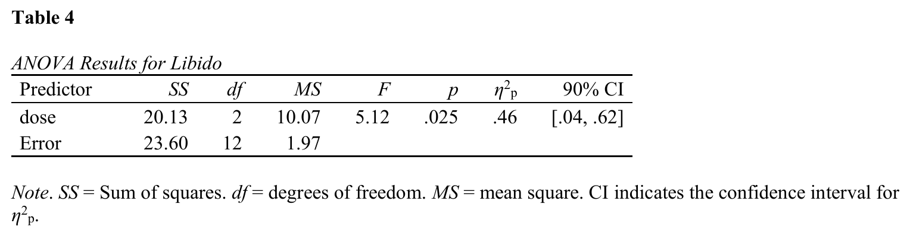

This table can also be placed in a [Quarto](https://quarto.org) document
– Quarto is a free system for writing documents that combine text and R
code. With the [apaquarto](https://wjschne.github.io/apaquarto/)
extension installed (one command; see the [installation
instructions](https://dstanley4.github.io/apaTables/articles/apaquarto-usage.html#installing-the-apaquarto-extension)),
the table appears fully formatted – number, title, and note included –
when the document is rendered to Word, PDF, or HTML. Tables go into the
document inside a “code chunk”: a small block of R code with a few
settings lines at the top. “Rendering” the document turns it into the
finished Word, PDF, or HTML file.

Every apaquarto document begins with a YAML header: the settings block
between `---` lines at the very top of the document. apaquarto needs an
author there – with no author, or an empty one, the render stops with a
LaTeX error – and it reports a problem unless that author has an
affiliation and is marked `corresponding: true`. This header is enough
to render:

``` yaml
---
title: "My Paper"
author:
  - name: Jane Doe
    corresponding: true
    affiliations:
      - name: University of Guelph
format: apaquarto-pdf
---
```

There are two ways to produce the chunk that holds the table; most users
only need the first.

**Easy way.** In the R console, create the table and then ask for the
Quarto code:

``` r

library(apaTables)

options(contrasts = c("contr.sum", "contr.poly"))
lm_output <- lm(libido ~ dose,
                data = viagra)

table4 <- apa.aov.table(lm_output = lm_output,
                        table.number = 4)

apa.quarto.template(x = table4)
```

This prints a ready-made Quarto code chunk. It carries no title or note
line and needs none:
[`apa.quarto.pdf()`](https://dstanley4.github.io/apaTables/reference/apa.quarto.pdf.md)
writes both from the table itself, every time you render. Copy the
printed chunk into your Quarto document, add the lines that create
`table4` to the chunk –
[`library(apaTables)`](https://github.com/dstanley4/apaTables) among
them; without it the document cannot find the apaTables commands and the
render stops. Then render the document.

**Advanced way.** Write the chunk yourself:

```` markdown
```{r}
#| label: tbl-anova4
#| message: false
#| warning: true
library(apaTables)
options(contrasts = c("contr.sum", "contr.poly"))
lm_output <- lm(libido ~ dose, data = viagra)
table4 <- apa.aov.table(lm_output = lm_output)
apa.quarto.pdf(x = table4)
```
````

The **apa.1way.table()** function creates a table with the mean and sd
for each cell; see Table 5.

``` r

library(apaTables)

table5 <- apa.1way.table(iv = dose,
                         dv = libido,
                         data = viagra,
                         table.number = 5)
```

``` r

apa.save(filename = "table5.docx",
         table5)
```

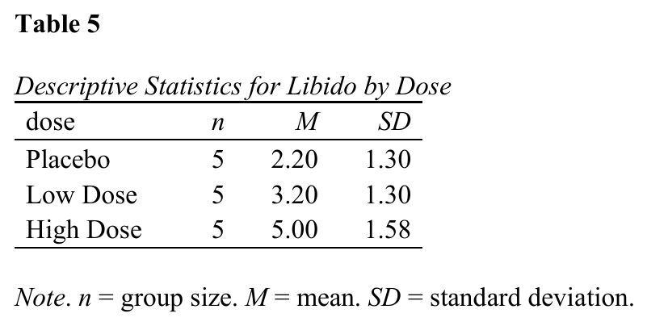

This table can also be placed in a [Quarto](https://quarto.org) document
– Quarto is a free system for writing documents that combine text and R
code. With the [apaquarto](https://wjschne.github.io/apaquarto/)
extension installed (one command; see the [installation
instructions](https://dstanley4.github.io/apaTables/articles/apaquarto-usage.html#installing-the-apaquarto-extension)),
the table appears fully formatted – number, title, and note included –
when the document is rendered to Word, PDF, or HTML. Tables go into the
document inside a “code chunk”: a small block of R code with a few
settings lines at the top. “Rendering” the document turns it into the
finished Word, PDF, or HTML file.

Every apaquarto document begins with a YAML header: the settings block
between `---` lines at the very top of the document. apaquarto needs an
author there – with no author, or an empty one, the render stops with a
LaTeX error – and it reports a problem unless that author has an
affiliation and is marked `corresponding: true`. This header is enough
to render:

``` yaml
---
title: "My Paper"
author:
  - name: Jane Doe
    corresponding: true
    affiliations:
      - name: University of Guelph
format: apaquarto-pdf
---
```

There are two ways to produce the chunk that holds the table; most users
only need the first.

**Easy way.** In the R console, create the table and then ask for the
Quarto code:

``` r

library(apaTables)

table5 <- apa.1way.table(iv = dose,
                         dv = libido,
                         data = viagra,
                         table.number = 5)

apa.quarto.template(x = table5)
```

This prints a ready-made Quarto code chunk. It carries no title or note
line and needs none:
[`apa.quarto.pdf()`](https://dstanley4.github.io/apaTables/reference/apa.quarto.pdf.md)
writes both from the table itself, every time you render. Copy the
printed chunk into your Quarto document, add the lines that create
`table5` to the chunk –
[`library(apaTables)`](https://github.com/dstanley4/apaTables) among
them; without it the document cannot find the apaTables commands and the
render stops. Then render the document.

**Advanced way.** Write the chunk yourself:

```` markdown
```{r}
#| label: tbl-means5
#| message: false
#| warning: true
library(apaTables)
table5 <- apa.1way.table(iv = dose, dv = libido, data = viagra)
apa.quarto.pdf(x = table5)
```
````

The **apa.d.table()** function show a d-value (with confidence interval)
for each paired comparison; see Table 6.

``` r

library(apaTables)

table6 <- apa.d.table(iv = dose,
                      dv = libido,
                      data = viagra,
                      table.number = 6)
```

``` r

apa.save(filename = "table6.docx",
         table6)
```

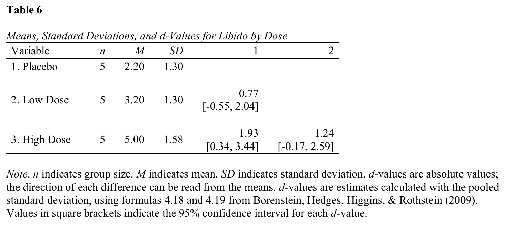

This table can also be placed in a [Quarto](https://quarto.org) document
– Quarto is a free system for writing documents that combine text and R
code. With the [apaquarto](https://wjschne.github.io/apaquarto/)
extension installed (one command; see the [installation
instructions](https://dstanley4.github.io/apaTables/articles/apaquarto-usage.html#installing-the-apaquarto-extension)),
the table appears fully formatted – number, title, and note included –
when the document is rendered to Word, PDF, or HTML. Tables go into the
document inside a “code chunk”: a small block of R code with a few
settings lines at the top. “Rendering” the document turns it into the
finished Word, PDF, or HTML file.

Every apaquarto document begins with a YAML header: the settings block
between `---` lines at the very top of the document. apaquarto needs an
author there – with no author, or an empty one, the render stops with a
LaTeX error – and it reports a problem unless that author has an
affiliation and is marked `corresponding: true`. This header is enough
to render:

``` yaml
---
title: "My Paper"
author:
  - name: Jane Doe
    corresponding: true
    affiliations:
      - name: University of Guelph
format: apaquarto-pdf
---
```

There are two ways to produce the chunk that holds the table; most users
only need the first.

**Easy way.** In the R console, create the table and then ask for the
Quarto code:

``` r

library(apaTables)

table6 <- apa.d.table(iv = dose,
                      dv = libido,
                      data = viagra,
                      table.number = 6)

apa.quarto.template(x = table6)
```

This prints a ready-made Quarto code chunk. It carries no title or note
line and needs none:
[`apa.quarto.pdf()`](https://dstanley4.github.io/apaTables/reference/apa.quarto.pdf.md)
writes both from the table itself, every time you render. Copy the
printed chunk into your Quarto document, add the lines that create
`table6` to the chunk –
[`library(apaTables)`](https://github.com/dstanley4/apaTables) among
them; without it the document cannot find the apaTables commands and the
render stops. Then render the document.

**Advanced way.** Write the chunk yourself:

```` markdown
```{r}
#| label: tbl-dvalues6
#| message: false
#| warning: true
library(apaTables)
table6 <- apa.d.table(iv = dose, dv = libido, data = viagra)
apa.quarto.pdf(x = table6)
```
````

## N-way ANOVA tables: 2-way Example

The 2-way example with independent variable predictors is based on the
*goggles* dataset from Field et al. (2012). When conducting an ANOVA in
*R* using the **lm()** command you must ensure your independent
variables are *R* factors and that contrasts are set correctly. Note:
repeated measures designs are supported via the **apa.afex.table()**
command.

``` r

options(contrasts = c("contr.sum", "contr.poly"))
lm_output <- lm(attractiveness ~ gender*alcohol,
                data = goggles)
```

The **apa.aov.table()** function creates a 2-way ANOVA table based on
lm_output; see Table 7.

``` r

library(apaTables)

table7 <- apa.aov.table(lm_output = lm_output,
                        table.number = 7)
```

``` r

apa.save(filename = "table7.docx",
         table7)
```

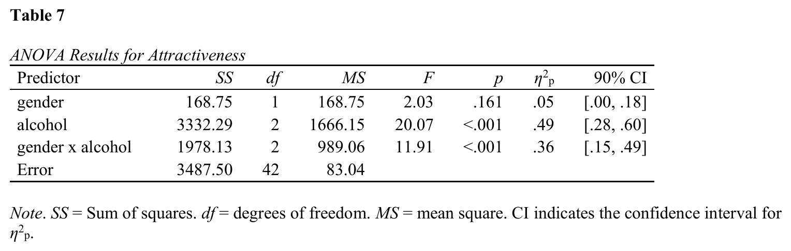

This table can also be placed in a [Quarto](https://quarto.org) document
– Quarto is a free system for writing documents that combine text and R
code. With the [apaquarto](https://wjschne.github.io/apaquarto/)
extension installed (one command; see the [installation
instructions](https://dstanley4.github.io/apaTables/articles/apaquarto-usage.html#installing-the-apaquarto-extension)),
the table appears fully formatted – number, title, and note included –
when the document is rendered to Word, PDF, or HTML. Tables go into the
document inside a “code chunk”: a small block of R code with a few
settings lines at the top. “Rendering” the document turns it into the
finished Word, PDF, or HTML file.

Every apaquarto document begins with a YAML header: the settings block
between `---` lines at the very top of the document. apaquarto needs an
author there – with no author, or an empty one, the render stops with a
LaTeX error – and it reports a problem unless that author has an
affiliation and is marked `corresponding: true`. This header is enough
to render:

``` yaml
---
title: "My Paper"
author:
  - name: Jane Doe
    corresponding: true
    affiliations:
      - name: University of Guelph
format: apaquarto-pdf
---
```

There are two ways to produce the chunk that holds the table; most users
only need the first.

**Easy way.** In the R console, create the table and then ask for the
Quarto code:

``` r

library(apaTables)

options(contrasts = c("contr.sum", "contr.poly"))
lm_output <- lm(attractiveness ~ gender*alcohol,
                data = goggles)

table7 <- apa.aov.table(lm_output = lm_output,
                        table.number = 7)

apa.quarto.template(x = table7)
```

This prints a ready-made Quarto code chunk. It carries no title or note
line and needs none:
[`apa.quarto.pdf()`](https://dstanley4.github.io/apaTables/reference/apa.quarto.pdf.md)
writes both from the table itself, every time you render. Copy the
printed chunk into your Quarto document, add the lines that create
`table7` to the chunk –
[`library(apaTables)`](https://github.com/dstanley4/apaTables) among
them; without it the document cannot find the apaTables commands and the
render stops. Then render the document.

**Advanced way.** Write the chunk yourself:

```` markdown
```{r}
#| label: tbl-anova7
#| message: false
#| warning: true
library(apaTables)
options(contrasts = c("contr.sum", "contr.poly"))
lm_output <- lm(attractiveness ~ gender*alcohol, data = goggles)
table7 <- apa.aov.table(lm_output = lm_output)
apa.quarto.pdf(x = table7)
```
````

The **apa.2way.table()** function creates a table with the mean and sd
for each cell; see Table 8. Marginal means can also be requested with
the *show.marginal.means* = TRUE. For higher-order designs (i.e., 3-way
or higher) use the **filter()** command in the *tidyverse* package to
select the subset of rows and then use **apa.2way.table()** to display
cell statistics.

``` r

library(apaTables)

table8 <- apa.2way.table(iv1 = gender,
                         iv2 = alcohol,
                         dv = attractiveness,
                         data = goggles,
                         show.marginal.means = TRUE,
                         table.number = 8)
```

``` r

apa.save(filename = "table8.docx",
         table8)
```

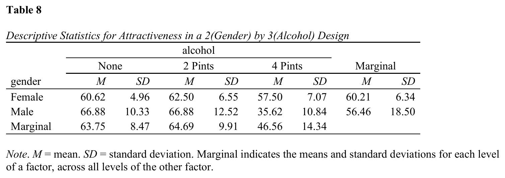

This table can also be placed in a [Quarto](https://quarto.org) document
– Quarto is a free system for writing documents that combine text and R
code. With the [apaquarto](https://wjschne.github.io/apaquarto/)
extension installed (one command; see the [installation
instructions](https://dstanley4.github.io/apaTables/articles/apaquarto-usage.html#installing-the-apaquarto-extension)),
the table appears fully formatted – number, title, and note included –
when the document is rendered to Word, PDF, or HTML. Tables go into the
document inside a “code chunk”: a small block of R code with a few
settings lines at the top. “Rendering” the document turns it into the
finished Word, PDF, or HTML file.

Every apaquarto document begins with a YAML header: the settings block
between `---` lines at the very top of the document. apaquarto needs an
author there – with no author, or an empty one, the render stops with a
LaTeX error – and it reports a problem unless that author has an
affiliation and is marked `corresponding: true`. This header is enough
to render:

``` yaml
---
title: "My Paper"
author:
  - name: Jane Doe
    corresponding: true
    affiliations:
      - name: University of Guelph
format: apaquarto-pdf
---
```

There are two ways to produce the chunk that holds the table; most users
only need the first.

**Easy way.** In the R console, create the table and then ask for the
Quarto code:

``` r

library(apaTables)

table8 <- apa.2way.table(iv1 = gender,
                         iv2 = alcohol,
                         dv = attractiveness,
                         data = goggles,
                         show.marginal.means = TRUE,
                         table.number = 8)

apa.quarto.template(x = table8)
```

This prints a ready-made Quarto code chunk. It carries no title or note
line and needs none:
[`apa.quarto.pdf()`](https://dstanley4.github.io/apaTables/reference/apa.quarto.pdf.md)
writes both from the table itself, every time you render. Copy the
printed chunk into your Quarto document, add the lines that create
`table8` to the chunk –
[`library(apaTables)`](https://github.com/dstanley4/apaTables) among
them; without it the document cannot find the apaTables commands and the
render stops. Then render the document.

**Advanced way.** Write the chunk yourself:

```` markdown
```{r}
#| label: tbl-means8
#| message: false
#| warning: true
library(apaTables)
table8 <- apa.2way.table(iv1 = gender, iv2 = alcohol,
                         dv = attractiveness, data = goggles,
                         show.marginal.means = TRUE)
apa.quarto.pdf(x = table8)
```
````

You can use the *tidyverse* package to conduct paired comparisons within
each gender again using **apa.d.table()**; see Tables 9 and 10.

``` r

library(apaTables)

library(dplyr)

goggles.men   <- filter(goggles,gender=="Male")
goggles.women <- filter(goggles,gender=="Female")

table9 <- apa.d.table(iv = alcohol,
                      dv = attractiveness,
                      data = goggles.men,
                      table.number = 9)

table10 <- apa.d.table(iv = alcohol,
                       dv = attractiveness,
                       data = goggles.women,
                       table.number = 10)
```

``` r

apa.save(filename = "tables9and10.docx",
         table9, table10)
```

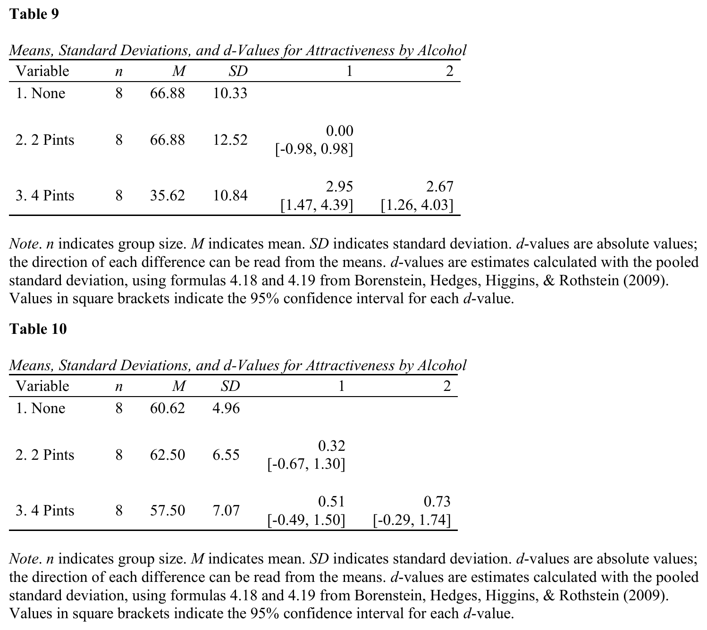

This table can also be placed in a [Quarto](https://quarto.org) document
– Quarto is a free system for writing documents that combine text and R
code. With the [apaquarto](https://wjschne.github.io/apaquarto/)
extension installed (one command; see the [installation
instructions](https://dstanley4.github.io/apaTables/articles/apaquarto-usage.html#installing-the-apaquarto-extension)),
the table appears fully formatted – number, title, and note included –
when the document is rendered to Word, PDF, or HTML. Tables go into the
document inside a “code chunk”: a small block of R code with a few
settings lines at the top. “Rendering” the document turns it into the
finished Word, PDF, or HTML file.

Every apaquarto document begins with a YAML header: the settings block
between `---` lines at the very top of the document. apaquarto needs an
author there – with no author, or an empty one, the render stops with a
LaTeX error – and it reports a problem unless that author has an
affiliation and is marked `corresponding: true`. This header is enough
to render:

``` yaml
---
title: "My Paper"
author:
  - name: Jane Doe
    corresponding: true
    affiliations:
      - name: University of Guelph
format: apaquarto-pdf
---
```

There are two ways to produce the chunk that holds the table; most users
only need the first.

**Easy way.** In the R console, create the tables and then ask for the
Quarto code:

``` r

library(apaTables)

library(dplyr)

goggles.men   <- filter(goggles,gender=="Male")
goggles.women <- filter(goggles,gender=="Female")

table9 <- apa.d.table(iv = alcohol,
                      dv = attractiveness,
                      data = goggles.men,
                      table.number = 9)

table10 <- apa.d.table(iv = alcohol,
                       dv = attractiveness,
                       data = goggles.women,
                       table.number = 10)

apa.quarto.template(x = table9)
apa.quarto.template(x = table10)
```

This prints ready-made Quarto code chunks. They carry no title or note
lines and need none:
[`apa.quarto.pdf()`](https://dstanley4.github.io/apaTables/reference/apa.quarto.pdf.md)
writes both from each table itself, every time you render. Copy each
printed chunk into your Quarto document, add the lines that create the
corresponding table object –
[`library(apaTables)`](https://github.com/dstanley4/apaTables) among
them; without it the document cannot find the apaTables commands and the
render stops. Then render the document.

**Advanced way.** Write the chunk yourself:

```` markdown
```{r}
#| label: tbl-dvalues9
#| message: false
#| warning: true
library(apaTables)
library(dplyr)
goggles.men <- filter(goggles, gender == "Male")
table9 <- apa.d.table(iv = alcohol, dv = attractiveness, data = goggles.men)
apa.quarto.pdf(x = table9)
```
````

The chunk for Table 10 contains a label, a line creating
`goggles.women`, and a call to **apa.d.table()**:

```` markdown
```{r}
#| label: tbl-dvalues10
#| message: false
#| warning: true
library(apaTables)
library(dplyr)
goggles.women <- filter(goggles, gender == "Female")
table10 <- apa.d.table(iv = alcohol, dv = attractiveness, data = goggles.women)
apa.quarto.pdf(x = table10)
```
````

## afex and apaTables: Repeated measures ANOVA

apaTables also supports repeated measures ANOVA tables and repeated
measures by between measures (mixed) ANOVA tables via **afex** output
from the *afex* package (specifically the
[`afex::aov_ez()`](https://rdrr.io/pkg/afex/man/aov_car.html) command).
The *ez* package was previously used for this purpose but has been
archived on CRAN; *afex* is now the recommended approach.

### Repeated Measures: 2-way design

Prior to beginning we ‘open’ the *apaTables*, *tidyverse*, and *afex*
packages using the library command as per below.

``` r

library(apaTables)
library(tidyverse)
library(afex)
```

In this example, we used the *drink_attitude* dataset from Field et
al. (2012). As before, this dataset is built into *apaTables* so it does
not need to be loaded using **read_csv()** or **read_sav()**. The
dataset (*drink_attitude_wide*) can be inspected with the **glimpse()**
command below (this provides information similar to SPSS variable view).
We use the “wide” descriptor in the name of the dataset to remind us
that the data is in the “wide” format where one row contains all the
data for one person. There are 20 participants so there are 20 rows.

``` r

glimpse(drink_attitude_wide)
```

The dataset represents an ANOVA with two repeated measures factors. It
is a 3 *drinks* (wine, beer, water) X 3 *imagery* (positive, negative,
neutral) design. The dataset uses 10 columns to represent this design.
The first column contains a code for each participant (P1, P2, etc.)
Note that the *participant* column is a factor as indicated by the
descriptor. The *participant* column must be a factor which can, as
noted previously, be created by the **as_factor()** command.

Each of the remaining 9 columns contain attitude ratings for a single
*drink/imagery* combination cell. The naming convention for column names
is critical to the workflow we describe below. Each column name
represents the level of the *drink* variable separated using an
underscore ( \_ ) from a level of the *imagery* variable. For example
the first column is called *beer_positive* representing the cell with a
combination of the *beer* level of *drink* and the positive level of
*imagery*. Each value in this column represents *attitude* for a
participant in this cell.

In order to conduct a repeated measures ANOVA we need to convert the
dataset from the wide format (where each row represents a person) to the
long format (where each row represents a single observation from a
person). We do this with a series of commands below.

``` r

drink_attitude_long <- tidyr::pivot_longer(drink_attitude_wide,
                              cols = beer_positive:water_neutral,
                              names_to = c("drink", "imagery"),
                              names_sep = "_",
                              values_to = "attitude")


drink_attitude_long$drink <- as_factor(drink_attitude_long$drink)
drink_attitude_long$imagery <- as_factor(drink_attitude_long$imagery)
```

We can inspect the final long version of the dataset with glimpse again:

``` r

glimpse(drink_attitude_long)
```

This output reveals the new data structure. There are now only four
columns where each row represents a single observation for a
participant. As before, the first column is factor column representing
*participant*. But each participant is represented nines times in this
column now - because each participant has nine observations (i.e., one
in each of the nine cells). Most importantly, we now have a single
column indicating level of *drink*, a single column indicating level of
*imagery*, and a column indicating the *attitude* rating.

You can see the first few rows in the more familiar format below:

``` r

head(drink_attitude_long)
```

We use the **aov_ez()** command from the *afex* package to conduct the
repeated measures ANOVA. We supply the participant id column
(*participant*), the dependent variable (*attitude*), and the two
within-participant factors (*drink* and *imagery*). Unlike the older
*ez* workflow, *afex* selects appropriate contrasts and applies a
Greenhouse-Geisser sphericity correction automatically, so the manual
[`contrasts()`](https://rdrr.io/r/stats/contrasts.html) and
`options(digits = ...)` steps are no longer required.

``` r

drink_attitude_results <- afex::aov_ez(id = "participant",
                                       dv = "attitude",
                                       data = drink_attitude_long,
                                       within = c("drink", "imagery"))
```

Now we make the table based on the output:

``` r

table11 <- apa.afex.table(afex.output = drink_attitude_results,
                          table.number = 11)
```

``` r

apa.save(filename = "table11.docx",
         table11)
```

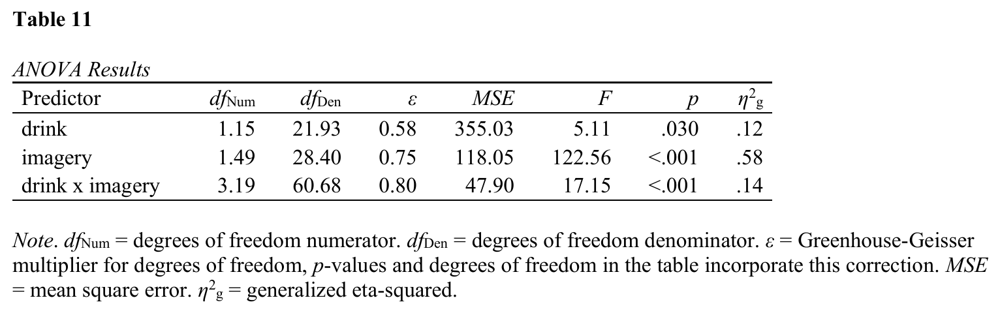

This table can also be placed in a [Quarto](https://quarto.org) document
– Quarto is a free system for writing documents that combine text and R
code. With the [apaquarto](https://wjschne.github.io/apaquarto/)
extension installed (one command; see the [installation
instructions](https://dstanley4.github.io/apaTables/articles/apaquarto-usage.html#installing-the-apaquarto-extension)),
the table appears fully formatted – number, title, and note included –
when the document is rendered to Word, PDF, or HTML. Tables go into the
document inside a “code chunk”: a small block of R code with a few
settings lines at the top. “Rendering” the document turns it into the
finished Word, PDF, or HTML file.

Every apaquarto document begins with a YAML header: the settings block
between `---` lines at the very top of the document. apaquarto needs an
author there – with no author, or an empty one, the render stops with a
LaTeX error – and it reports a problem unless that author has an
affiliation and is marked `corresponding: true`. This header is enough
to render:

``` yaml
---
title: "My Paper"
author:
  - name: Jane Doe
    corresponding: true
    affiliations:
      - name: University of Guelph
format: apaquarto-pdf
---
```

There are two ways to produce the chunk that holds the table; most users
only need the first.

**Easy way.** In the R console, create the table and then ask for the
Quarto code:

``` r

library(apaTables)
library(tidyverse)
library(afex)

drink_attitude_long <- tidyr::pivot_longer(drink_attitude_wide,
                              cols = beer_positive:water_neutral,
                              names_to = c("drink", "imagery"),
                              names_sep = "_",
                              values_to = "attitude")

drink_attitude_long$drink <- as_factor(drink_attitude_long$drink)
drink_attitude_long$imagery <- as_factor(drink_attitude_long$imagery)

drink_attitude_results <- afex::aov_ez(id = "participant",
                                       dv = "attitude",
                                       data = drink_attitude_long,
                                       within = c("drink", "imagery"))

table11 <- apa.afex.table(afex.output = drink_attitude_results,
                          table.number = 11)

apa.quarto.template(x = table11)
```

This prints a ready-made Quarto code chunk. It carries no title or note
line and needs none:
[`apa.quarto.pdf()`](https://dstanley4.github.io/apaTables/reference/apa.quarto.pdf.md)
writes both from the table itself, every time you render. Copy the
printed chunk into your Quarto document, add the lines that create
`table11` to the chunk –
[`library(apaTables)`](https://github.com/dstanley4/apaTables) among
them; without it the document cannot find the apaTables commands and the
render stops. Then render the document.

**Advanced way.** Write the chunk yourself:

```` markdown
```{r}
#| label: tbl-anova11
#| message: false
#| warning: true
library(apaTables)
library(tidyverse)
library(afex)
drink_attitude_long <- tidyr::pivot_longer(drink_attitude_wide,
                          cols = beer_positive:water_neutral,
                          names_to = c("drink", "imagery"),
                          names_sep = "_",
                          values_to = "attitude")
drink_attitude_long$drink <- as_factor(drink_attitude_long$drink)
drink_attitude_long$imagery <- as_factor(drink_attitude_long$imagery)
drink_attitude_results <- afex::aov_ez(id = "participant",
                                       dv = "attitude",
                                       data = drink_attitude_long,
                                       within = c("drink", "imagery"))
table11 <- apa.afex.table(afex.output = drink_attitude_results)
apa.quarto.pdf(x = table11)
```
````

### Repeated Measures and Independent Groups: 3-way design

Prior to beginning we ‘open’ the *apaTables*, *tidyverse*, and *afex*
packages using the library command as per below.

``` r

library(apaTables)
library(tidyverse)
library(afex)
```

In this example, we used the dating dataset from Field et al. (2012). As
before, this dataset is built into apaTables. The dataset
(*dating_wide*) can be inspected with the **glimpse()** command below
(this provides information similar to SPSS variable view). We use the
“wide” descriptor in the name of the dataset to remind us that the data
is in the “wide” format where one row contains all the data for one
person. There are 20 participants so there are 20 rows.

``` r

glimpse(dating_wide)
```

The dataset represents an ANOVA with one independent groups factor and
two repeated measures factors. It is a 2 *gender* (male, female) by 3
*looks* (attractive, average, ugly) X 3 *personality* (high, some, none)
design. The dataset uses 11 columns to represent this design. The first
column contains a code for each participant (P1, P2, etc.) Note that the
*participant* column is a factor as indicated by the descriptor. The
second column is used to indicate the gender of each participant. Both
the *participant* and *gender* columns are factors.

Each of the remaining 9 columns contain attitude ratings for a single
*looks/personality* combination cell. The naming convention for column
names is critical to the workflow we describe below. Each column name
represents the level of the *looks* variable separated using an
underscore ( \_ ) from a level of the *personality* variable. For
example the first column is called *attractive_high* representing the
cell with a combination of the attractive level of *looks* and the high
level of *personality*. Each value in this column represents *date
rating* for a participant in this cell.

In order to conduct a mixed between/within ANOVA we need to convert the
dataset from the wide format (where each row represents a person) to the
long format (where each row represents a single observation from a
person) – taking into account the independent groups factors (*gender*).
We do this with a series of commands below.

``` r


dating_long <- tidyr::pivot_longer(dating_wide,
                                   cols = attractive_high:ugly_none,
                                   names_to = c("looks", "personality"),
                                   names_sep = "_",
                                   values_to = "date_rating")


dating_long$looks <- as_factor(dating_long$looks)
dating_long$personality <- as_factor(dating_long$personality)
```

We can inspect the final long version of the dataset with glimpse again:

``` r

glimpse(dating_long)
```

This output reveals the new data structure. There are now only five
columns where each row represents a single observation for a
participant. As before, the first column is factor column representing
*participant*. But each participant is represented nines times in this
column now - because each participant has nine observations (i.e., one
in each of the nine cells). The second column contains the *gender*
factor. The third column indicates the level of *looks*, and the fourth
column indicates the level of *personality*. The fifth column indicates
the *date_rating*.

You can see the first few rows in the more familiar format below:

``` r

head(dating_long)
```

We use the **aov_ez()** command from the *afex* package to conduct the
mixed ANOVA. We supply the participant id column (*participant*), the
dependent variable (*date_rating*), the between-participant factor
(*gender*), and the two within-participant factors (*looks* and
*personality*). As above, *afex* selects appropriate contrasts and
applies a sphericity correction automatically, so the manual
[`contrasts()`](https://rdrr.io/r/stats/contrasts.html) and
`options(digits = ...)` steps are no longer required.

``` r

dating_results <- afex::aov_ez(id = "participant",
                               dv = "date_rating",
                               data = dating_long,
                               between = "gender",
                               within = c("looks", "personality"))
```

Now we make the table based on the output:

``` r

table12 <- apa.afex.table(afex.output = dating_results,
                          table.number = 12)
```

``` r

apa.save(filename = "table12.docx",
         table12)
```

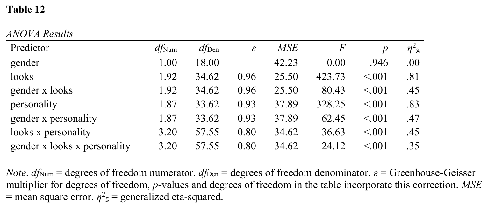

This table can also be placed in a [Quarto](https://quarto.org) document
– Quarto is a free system for writing documents that combine text and R
code. With the [apaquarto](https://wjschne.github.io/apaquarto/)
extension installed (one command; see the [installation
instructions](https://dstanley4.github.io/apaTables/articles/apaquarto-usage.html#installing-the-apaquarto-extension)),
the table appears fully formatted – number, title, and note included –
when the document is rendered to Word, PDF, or HTML. Tables go into the
document inside a “code chunk”: a small block of R code with a few
settings lines at the top. “Rendering” the document turns it into the
finished Word, PDF, or HTML file.

Every apaquarto document begins with a YAML header: the settings block
between `---` lines at the very top of the document. apaquarto needs an
author there – with no author, or an empty one, the render stops with a
LaTeX error – and it reports a problem unless that author has an
affiliation and is marked `corresponding: true`. This header is enough
to render:

``` yaml
---
title: "My Paper"
author:
  - name: Jane Doe
    corresponding: true
    affiliations:
      - name: University of Guelph
format: apaquarto-pdf
---
```

There are two ways to produce the chunk that holds the table; most users
only need the first.

**Easy way.** In the R console, create the table and then ask for the
Quarto code:

``` r

library(apaTables)
library(tidyverse)
library(afex)

dating_long <- tidyr::pivot_longer(dating_wide,
                                   cols = attractive_high:ugly_none,
                                   names_to = c("looks", "personality"),
                                   names_sep = "_",
                                   values_to = "date_rating")

dating_long$looks <- as_factor(dating_long$looks)
dating_long$personality <- as_factor(dating_long$personality)

dating_results <- afex::aov_ez(id = "participant",
                               dv = "date_rating",
                               data = dating_long,
                               between = "gender",
                               within = c("looks", "personality"))

table12 <- apa.afex.table(afex.output = dating_results,
                          table.number = 12)

apa.quarto.template(x = table12)
```

This prints a ready-made Quarto code chunk. It carries no title or note
line and needs none:
[`apa.quarto.pdf()`](https://dstanley4.github.io/apaTables/reference/apa.quarto.pdf.md)
writes both from the table itself, every time you render. Copy the
printed chunk into your Quarto document, add the lines that create
`table12` to the chunk –
[`library(apaTables)`](https://github.com/dstanley4/apaTables) among
them; without it the document cannot find the apaTables commands and the
render stops. Then render the document.

**Advanced way.** Write the chunk yourself:

```` markdown
```{r}
#| label: tbl-anova12
#| message: false
#| warning: true
library(apaTables)
library(tidyverse)
library(afex)
dating_long <- tidyr::pivot_longer(dating_wide,
                                   cols = attractive_high:ugly_none,
                                   names_to = c("looks", "personality"),
                                   names_sep = "_",
                                   values_to = "date_rating")
dating_long$looks <- as_factor(dating_long$looks)
dating_long$personality <- as_factor(dating_long$personality)
dating_results <- afex::aov_ez(id = "participant",
                               dv = "date_rating",
                               data = dating_long,
                               between = "gender",
                               within = c("looks", "personality"))
table12 <- apa.afex.table(afex.output = dating_results)
apa.quarto.pdf(x = table12)
```
````

## References

Field, A., Miles, J., & Field, Z. (2012). *Discovering statistics using
R*. Sage.

Nuijten, M. B., Hartgerink, C. H. J., van Assen, M. A. L. M., Epskamp,
S., & Wicherts, J. M. (2016). The prevalence of statistical reporting
errors in psychology (1985-2013). *Behavior Research Methods, 48*(4),
1205-1226. <https://doi.org/10.3758/s13428-015-0664-2>
